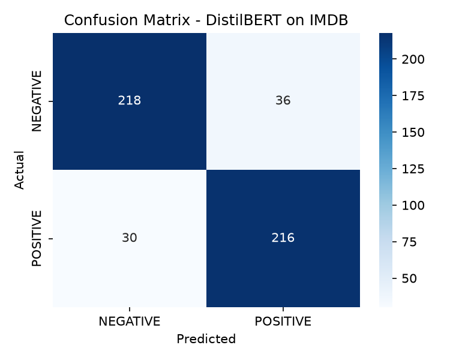

# Sentiment Analysis with a Fine-Tuned DistilBERT

Binary sentiment classification of movie reviews, built by fine-tuning
`distilbert-base-uncased` on the IMDB dataset using Hugging Face Transformers.

## Results

Trained on 2,000 reviews and evaluated on 500 held-out reviews (CPU only).

| Metric   | Score |
|----------|-------|
| Accuracy | 86.8% |
| F1       | 0.867 |

| Class    | Precision | Recall | F1    |
|----------|-----------|--------|-------|
| NEGATIVE | 0.879     | 0.858  | 0.869 |
| POSITIVE | 0.857     | 0.878  | 0.867 |



## Project Structure

```
src/
  train.py            # fine-tune DistilBERT on an IMDB subset
  evaluate_model.py   # classification report + confusion matrix
  predict.py          # run predictions on new text
requirements.txt
```

## How to Run

```bash
python -m venv venv
venv\Scripts\activate        # Windows
pip install -r requirements.txt

python src/train.py          # saves the model to outputs/model
python src/evaluate_model.py
python src/predict.py "I really enjoyed this film"
```

Training on 2,000 samples took about 2 hours on a CPU. Increase `TRAIN_SIZE`
in `train.py` for higher accuracy (full IMDB typically reaches about 92-93%).

## Limitations

- Trained on only 2,000 reviews, so accuracy is lower than a full-data run.
- IMDB has only positive and negative labels, so neutral or mixed reviews
  get forced into one class, usually with low confidence.
- Trained on movie reviews, so performance may drop on other domains.

## Tech Stack

Python, PyTorch, Hugging Face Transformers and Datasets, scikit-learn, matplotlib, seaborn